# Beztakets user guide

Beztakets is the help desk for Beztak's HR and Operations team. Employee questions arrive as tickets, an AI assistant answers what it safely can from the Beztak Operations Manual, and a person handles everything else. This guide walks through each screen, step by step.

All names, emails and tickets in the screenshots are made up.

**In this guide:** [Sign in](#1-sign-in) · [Tickets](#2-your-tickets) · [Reply to a ticket](#3-open-and-answer-a-ticket) · [New ticket](#4-open-a-ticket-yourself) · [Ask Beztak chat](#5-ask-beztak-the-chat-bubble) · [Reports](#6-reports) · [Gaps](#7-gaps-where-the-manual-is-missing-answers) · [Learned](#8-learned-teaching-the-assistant) · [Documents](#9-documents-and-the-assistants-manual) · [Setup and profile](#10-setup-and-your-profile) · [On a phone](#11-using-it-on-a-phone) · [Problems](#if-something-looks-wrong)

---

## 1. Sign in

1. Open the Beztakets address your team lead gave you.
2. Type your **Email** and **Password**, then click **Sign in**.

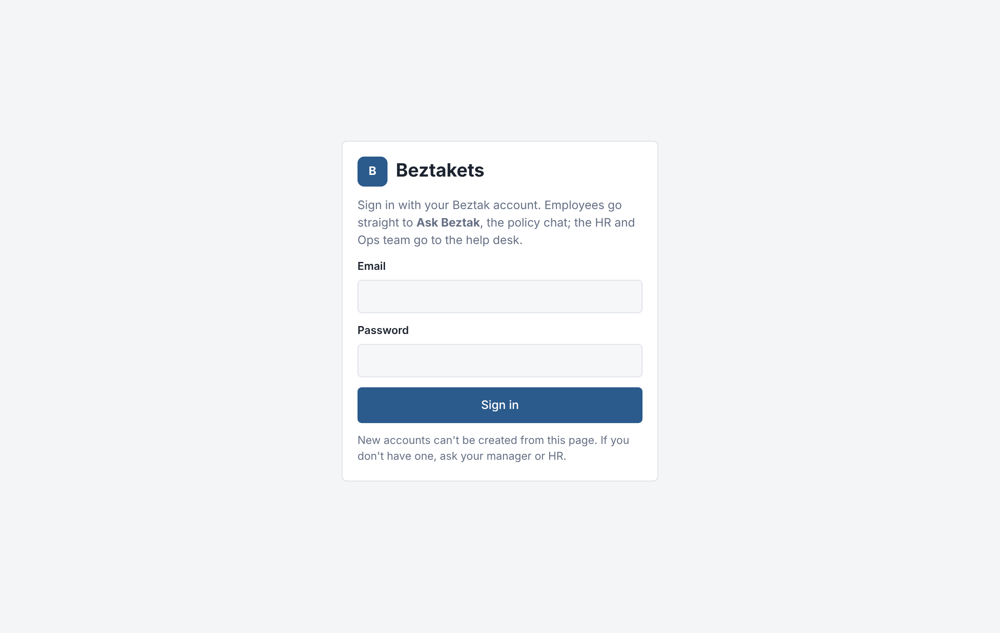

- Accounts are created by your team lead. You cannot create one on this page.
- Who you are comes from your email. If it starts with a team member's name (for example `dana.whitfield@…`), you see that person's tickets. A login that matches nobody sees the desk as Dana Whitfield, and the profile page says so.

## 2. Your tickets

Click **Tickets** (left side, or the bottom bar on a phone). You only see tickets assigned to you, or where a teammate asked for your advice.

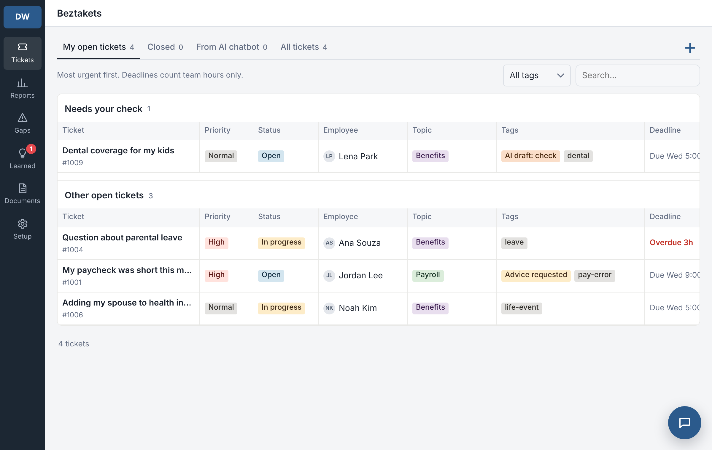

**The tabs**

| Tab | What is in it |
|---|---|
| **My open tickets** | Everything a person still needs to answer, most urgent first. |
| **Closed** | Two groups: **AI answered** (the assistant replied and nothing more was needed) and **Closed by you**. |
| **From AI chatbot** | Your tickets that began as a chat in the Ask Beztak bubble, newest first. |
| **All tickets** | Everything you can see. |

**Inside "My open tickets"** the list is split in two:

- **Needs your check**: the AI has already written a reply for each of these. Open one, read the reply, then send or edit it. Nothing is sent until you do.
- **Other open tickets**: everything else.

**Tags on a row** tell you why a ticket needs attention: *Due soon*, *Advice requested* (a teammate asked for your advice), *AI draft: check*, *Asked for a person*, *Employee follow-up*.

**Finding things:** type in **Search…** (matches the subject, the employee's name and email, and tags) or pick a tag from **All tags**. Deadlines count team hours only (Monday to Friday, 9:00 am to 5:00 pm), so a ticket opened on Friday evening is not overdue on Saturday.

## 3. Open and answer a ticket

Click any row to open it.

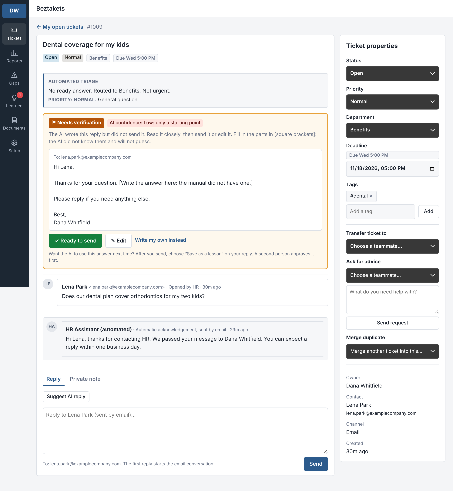

1. **Read the top box.** *Automated triage* says how the ticket was routed and whether it is urgent.
2. **Check the AI's reply** (the orange *Needs verification* box). The AI wrote it but did not send it. Anything in `[square brackets]` is something the AI did not know and will not guess: fill it in.
   - **Ready to send** sends the reply as written. If a `[blank]` is still in it, the desk opens the editor so you can fill it in first.
   - **Edit** lets you change it first.
   - **Write my own instead** hides the AI's reply.
3. **Or write your own.** Use the **Reply** tab at the bottom. **Suggest AI reply** asks the assistant for a draft. **Private note** adds a note only your team sees.
4. Click **Send**. Replies go to the employee by email.
5. **Right-hand side, Ticket properties:**
   - **Status, Priority, Department, Deadline, Tags**: change them if the automatic choice is wrong.
   - **Transfer ticket to**: hand it to a teammate (it moves to their list).
   - **Ask for advice**: pick a teammate and write a question. They see it as *Advice requested* and answer without taking over the ticket.
   - **Merge duplicate**: fold another ticket from the same person into this one.
6. **Teach the assistant (optional).** Under a reply you sent, **Save as a lesson** turns it into a short answer the AI may use next time, after a teammate approves it (see [Learned](#8-learned-teaching-the-assistant)).

## 4. Open a ticket yourself

For a phone call or a hallway question: click the **+** at the top right of the ticket list.

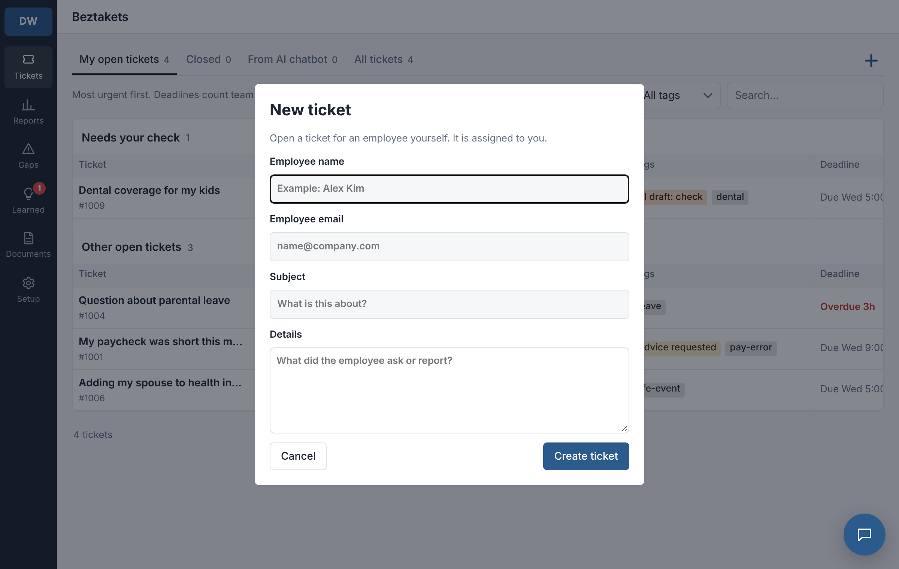

Fill in the employee's **name**, **email**, a **subject** and the **details**, then click **Create ticket**. It is assigned to you. The first reply you send starts an email conversation with the employee.

## 5. Ask Beztak: the chat bubble

The round chat button at the bottom right is the **Ask Beztak** assistant. Employees use the same chat (on the company intranet, once the bubble is added there), and you can use it too: for example, to find an answer fast while replying to a ticket.

**Starting a chat**

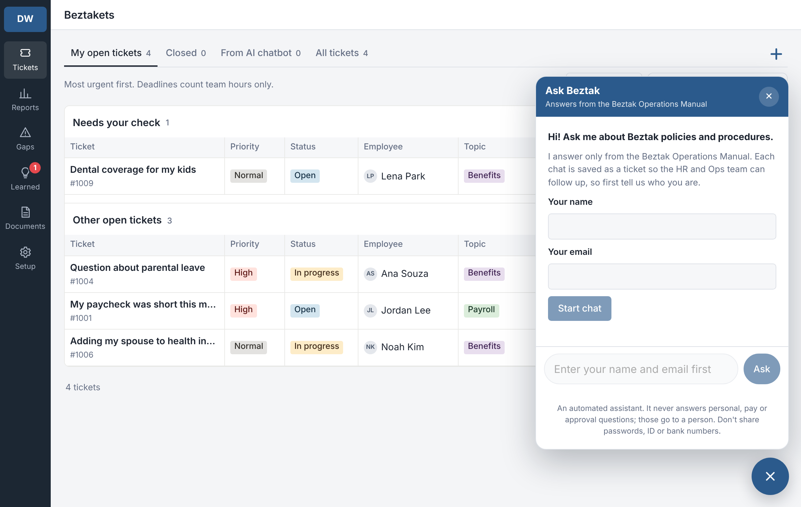

1. Click the round button.
2. Type your **name** and **email**, then **Start chat**. Every chat is saved as a ticket, so we need to know who is asking. The details are asked each time and are not remembered in the desk's bubble.
3. Type a question and click **Ask**.

**When it can answer.** It answers straight from the Operations Manual and shows the section it used (the small grey tag such as *2.1 · When is rent due?*). In the desk, **Use in reply** adds the answer to the reply box of the ticket you have open. Check it before you send.

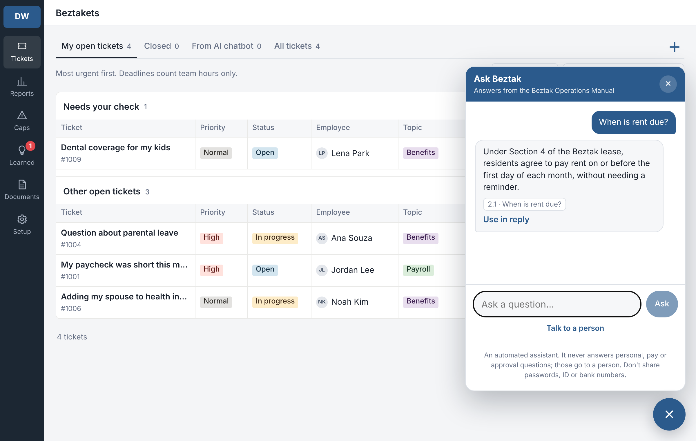

**When it can't answer.** It says so, creates a ticket with the question, the person's name and their email, and promises a reply within 24 hours. The ticket appears in the right person's list.

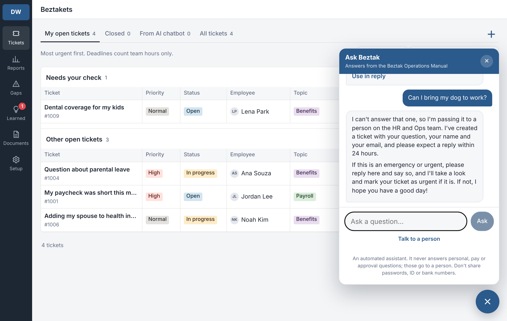

**If it is urgent.** The person can reply "it's urgent". The assistant then asks what makes it urgent. It marks the ticket urgent only when the situation fits the team's rules, for example pay not received, a safety concern, lost coverage, or a deadline today or tomorrow. If it does not fit, it says so and a person still replies within 24 hours. Real emergencies (a flood, an injury, a threat) get the safety step straight away, such as calling 911 or the on-call line, and the ticket is marked urgent.

The assistant never answers personal, pay or approval questions, and never guesses: those always go to a person.

## 6. Reports

Click **Reports** for a quick look at your own workload: open tickets, urgent, overdue, advice requested, answered by the AI, closed, and a bar chart of your tickets by department.

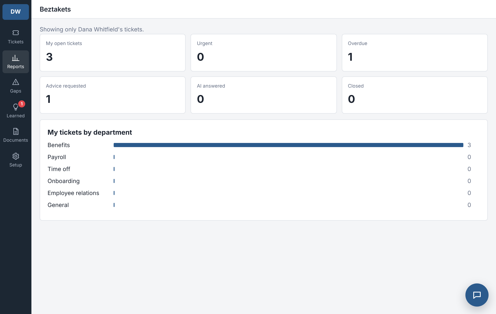

## 7. Gaps: where the manual is missing answers

Click **Gaps**. This page uses the questions the assistant could and could not answer to show where the Operations Manual needs work.

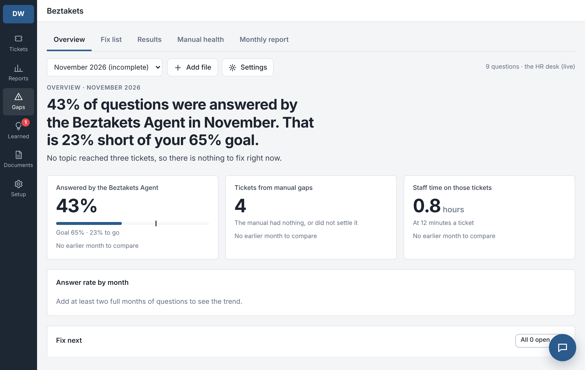

- **Overview**: the share of questions the Beztakets Agent answered this month against the team's goal, and what to fix next.
- **Fix list**: topics employees keep asking about that the manual does not cover, most asked first. Click a topic to see how employees word it and what staff answered. **Suggest wording** asks the AI to draft a manual entry from those staff answers. It never invents a number or policy: anything it does not know is a `[blank]` for you to fill in, and a person must check every fact before it goes in the manual. **Copy** puts the draft on your clipboard. Without the AI connected you get a starting template instead.
- **Results**: did the fixes work? Tickets before and after each fix.
- **Manual health**: manual sections that are cited often but did not settle the question, and sections that are never cited.
- **Monthly report**: a summary for sharing progress with leadership and keeping owners on track.

Click **Add file** to bring in more question history. Everything on this page is calculated from the tickets on the desk.

## 8. Learned: teaching the assistant

Click **Learned**. The assistant only knows the manual plus the **lessons** on this page: short answers the team wrote and a second person approved.

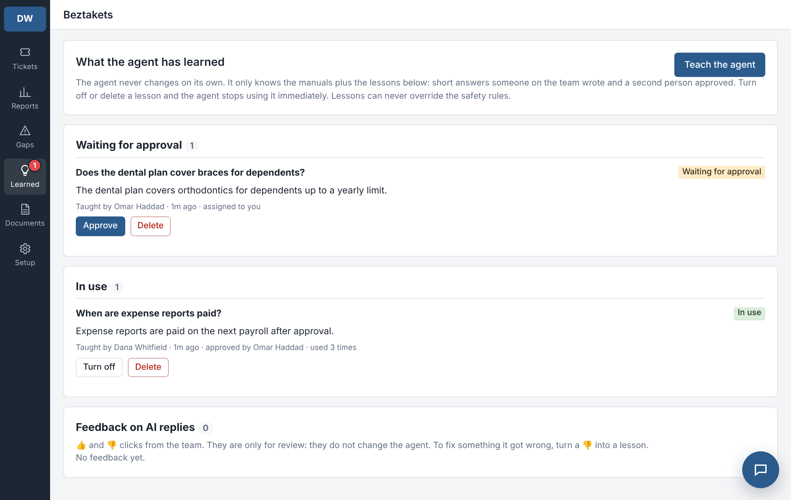

- A **red circle** with a number on the Learned icon means that many lessons are waiting for **you** to approve.
- Every new lesson is assigned to one teammate to approve (the person who handles that topic, never the person who wrote it). It says *assigned to you* or *assigned to Omar Haddad*. Only the assigned person sees **Approve**.
- **Teach the agent** writes a new lesson. Write the question the way an employee would ask it and an answer that is right for everyone. No names, ID numbers or anything about one person.
- **Turn off** and **Delete** stop the assistant using a lesson immediately.
- 👍 / 👎 under AI replies are kept at the bottom of this page. They are for review only and never change the assistant by themselves.

## 9. Documents and the assistant's manual

Click **Documents**.

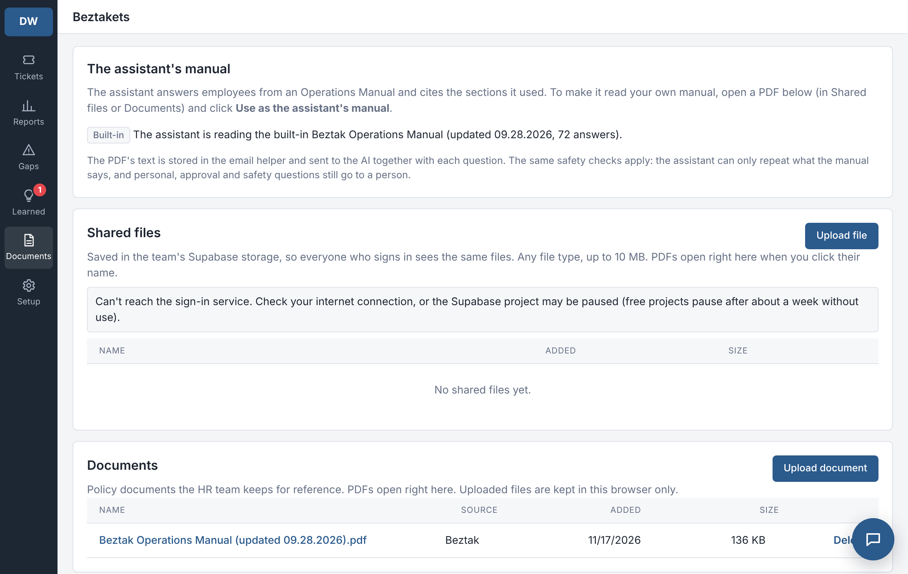

- **The assistant's manual** shows what the AI reads. By default it is the built-in Beztak Operations Manual. To make it read your own PDF, open the PDF below and click **Use as the assistant's manual**. **Go back to the built-in manual** undoes it.
- **Shared files** are saved for everyone who signs in (any file type, up to 10 MB).
- **Documents** lists reference files kept in this browser. **Upload document** accepts PDF, .txt, .md and .csv. Click a name to read it.
- Further down you can see exactly what the assistant answers from, and the list of questions it **never** answers automatically.

## 10. Setup and your profile

**Setup** (left menu) explains how the AI learns, links to the safety checks (the *Guardrails* page, which proves the assistant only answers what it safely can), and shows the email connection status.

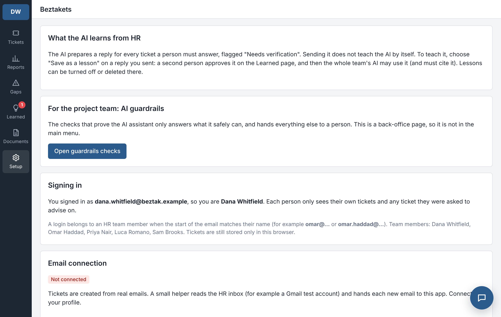

Click your **initials** (top left) for your **profile**: appearance (light, dark, match my device), email notifications, out of office, the email connection, and **Sign out**.

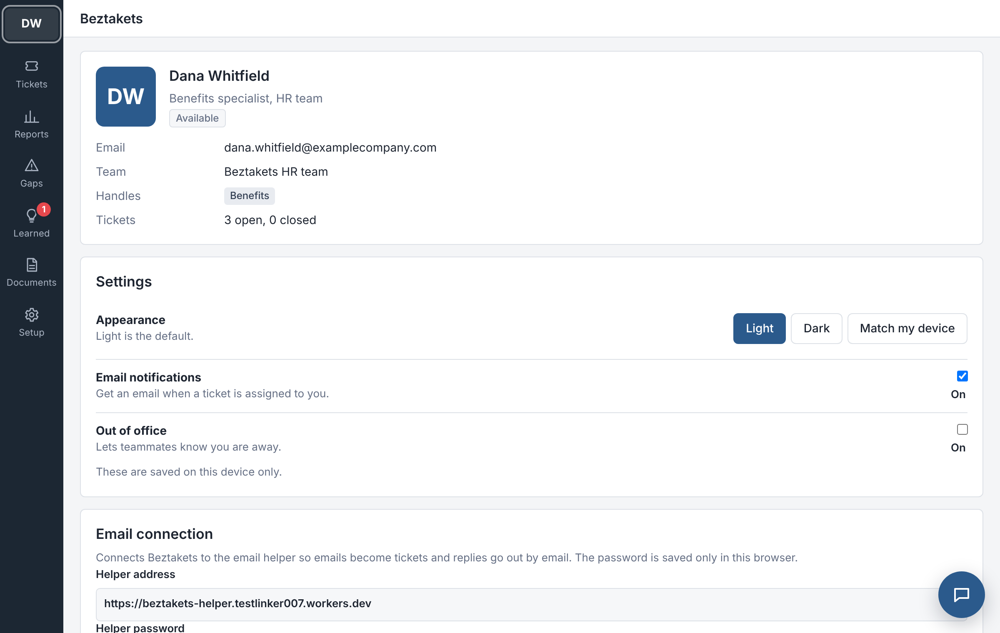

**Connecting email.** Tickets from email and chat only arrive once the desk is connected to the email helper. In your profile, paste the **helper password** your team lead gave you. The status line then shows when the helper last checked the inbox. **Check for new emails now** forces a check.

## 11. Using it on a phone

The menu moves to the bottom of the screen and the ticket table scrolls sideways, so swipe to see Tags, Deadline and Owner.

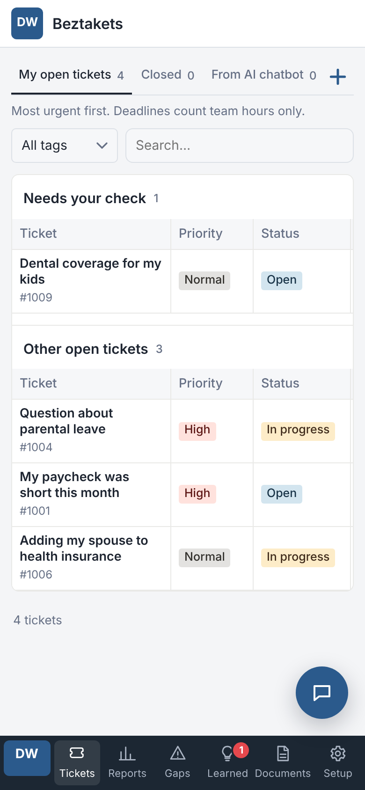

## If something looks wrong

| What you see | What to do |
|---|---|
| "That email or password isn't right" | Check both, or ask your team lead to reset your password. |
| No new tickets from email | Open your profile: is the helper connected? Use **Check for new emails now** and read the status line. |
| The chat says it couldn't reach the help desk | The email helper is offline. Ask your team lead to check it. The employee can email HR instead. |
| Answers feel like word matching, not an AI | The AI key is missing from the helper. Ask your team lead (see the README). |
| A ticket is missing | You only see your own tickets and ones where you were asked for advice. Ask a teammate to transfer it. |
